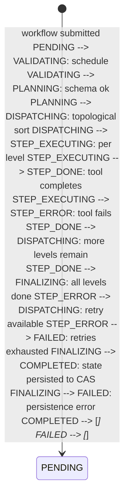

# Conductor Crate Instructions

Crate-local guidance for `src/mediapm-conductor/`. Conductor is the deterministic workflow engine: Nickel-defined steps are topologically planned, dispatched to workers, and captured to CAS. Pure workflows are deterministic; impure ones may vary on retries. Follow with root `AGENTS.md` and relevant `.agents/instructions/*.instructions.md`.

## Scope

- Applies to all files under `src/mediapm-conductor/`.
- Root `AGENTS.md` is the workspace-wide baseline; this file owns conductor-specific design and behavior. On conflict, root `AGENTS.md` wins for global policy.

## Orchestration contract

- Keep conductor as a functional orchestration engine over CAS: deterministic planning/keying in pure logic, with process/filesystem effects isolated to execution boundaries.
- Keep user intent and machine-managed runtime state separated across `conductor.ncl` and `conductor.generated.ncl`; unresolved non-mergeable conflicts fail fast and require manual resolution.
- Runtime orchestration remains async + actor-oriented (`ractor`) with explicit message contracts and predictable supervision behavior.
- Workflow steps reference tools by `ToolSpec.name` (e.g. `tool: "echo"`), never by the tools map key (e.g. `"echo@v1"`); `find_tool_by_name` matches `spec.name`.

## Current Stack and Entry Points

Use concrete files as source of truth:

- Crate manifest: `src/mediapm-conductor/Cargo.toml`
- Library entry: `src/mediapm-conductor/src/lib.rs`
- CLI entry: `src/mediapm-conductor/src/main.rs`
- CLI implementation: `src/mediapm-conductor/src/cli.rs`
- Runtime orchestration: `src/mediapm-conductor/src/orchestration/coordinator.rs`, `src/mediapm-conductor/src/orchestration/actors/`, `src/mediapm-conductor/src/orchestration/protocol.rs`
- Config model: `src/mediapm-conductor/src/config/mod.rs`
- State model: `src/mediapm-conductor/src/state/mod.rs`
- Versioned config schema + migration bridge: `src/mediapm-conductor/src/config/versions/`

Key ecosystem (from `Cargo.toml`):

- Async runtime: `tokio`
- Actor framework: `ractor`
- Serialization: `serde`, `serde_json`
- CAS integration: `mediapm-cas`
- Hashing: `blake3`
- CLI: `clap`

## CLI/API Parity Contract

- Keep conductor CLI operations API-backed by default: command handlers in `src/mediapm-conductor/src/cli.rs` should call `ConductorApi` methods (through `Conductor`) instead of duplicating orchestration logic.
- When adding or changing CLI commands, update `ConductorApi` and actor-client routing in the same change if behavior must be available programmatically.
- CLI-only ergonomics (argument parsing, editor/environment precedence, output formatting) may differ, but validation and mutation semantics must match API paths.

## Progress bar boundary (no indicatif in library)

The conductor library must not depend on indicatif directly. Progress is communicated via `RunWorkflowOptions.progress_group: Option<Arc<dyn ProgressGroupApi + Send + Sync>>`. The conductor composes the workflow screen from this group. The conductor CLI binary builds a `ProgressGroup` and passes it. `DownloadProgressSnapshot` and `ProgressCallback` from `mediapm-utils` are available in the library for download progress.

All progress bar rendering, templates, glyphs, colors, prefix/suffix shapes, truncation dispatch, per-screen specs, post-finish result messages, output stream policy, and the module boundary rule live in `progress-output.instructions.md` and `progress-budget.instructions.md`. Read those files before editing progress code. The actual rendered format is also verified by `src/mediapm-utils/tests/progress_output/*.rs`; never invent ASCII mocks.

## Configuration Document Model

Conductor uses two config documents plus one runtime state file:

- User-edited config: `conductor.ncl`
- Program-edited config: `conductor.generated.ncl`
- Runtime state file: pretty JSON of the current `ConductorState`, at `RuntimeStoragePaths.state_file_path` (from `RunWorkflowOptions.runtime_storage_paths`), default `.conductor/state.json`

Grouped runtime path defaults:

- runtime root (`conductor_dir`): `.conductor`
- state file path (`state_file_path`, mediapm passes it through `conductor_state_config`): `<conductor_dir>/state.json`
- filesystem CAS store (`cas_store_dir`): `<conductor_dir>/store`
- contract export directory: `<conductor_dir>/config/conductor`
- tool-content cache directory (`conductor_tools_dir`): `<conductor_dir>/tools`

Contract export behavior contract:

- both CLI workflow entrypoints and API workflow execution must export the conductor contract sources — `mod.ncl` and every version file its registry imports — to `<conductor_dir>/config/conductor` before runtime execution continues, so the directory evaluates on its own. `Conductor::export_schemas` and its `export-schemas` CLI verb keep their names; what they write is the Nickel the runtime evaluates, never a JSON schema.

Document contract:

- `conductor.ncl` is treated as user-edited input and is not machine-mutated.
- `conductor.generated.ncl` stores machine-managed setup/config declarations.
- `conductor.ncl` and `conductor.generated.ncl` may define grouped runtime storage fields under one `runtime` record: `runtime.conductor_dir`, `runtime.conductor_state_config`, `runtime.cas_store_dir`, and optional platform-keyed inherited host env-name map `runtime.inherited_env_vars`. The `cas_store_dir` field accepts any CAS locator string (filesystem path or URL). `runtime.inherited_env_vars` (v2: `runtime.platform_inherited_env_vars`) is a closed record restricted to `windows`/`linux`/`macos` keys; unknown platform keys are rejected.
- Runtime inherited env-name defaults are host-specific (`SYSTEMROOT`, `WINDIR`, `TEMP`, `TMP` on Windows; empty list elsewhere) and merge user, machine, and invocation-option values with case-insensitive de-duplication.
- Payload staging is decided at two levels, and the document schema that carries the pair is v4: `runtime.payload_staging` is the default a tool that names none takes (`in_place` when absent), and `tools.<tool>.runtime.payload_staging` is that tool's choice — `inherit`, the default, or one of the three strategies. `ConfigPayloadStaging` is the choice type and `PayloadStaging` the strategy it resolves to; `NickelDocument::effective_payload_staging` resolves the pair while the document is read, so `to_unified` writes a concrete strategy onto every unified tool and nothing downstream holds `inherit`.
- Validation judges the resolved strategy, so a tool with a content map that inherits `in_place` or `hard_link` still needs the `payload_root` that strategy reads, and the error says when the strategy came from the document default rather than from the tool.
- The encoder states each decision once: a tool's choice only where it differs from the resolved default, and the document default only where it is not `in_place`. The rule is loadability, not size: mediapm merges its user document over the generated one, an absent field already means `in_place`, and a generated `in_place` would be a second explicit statement that conflicts with a user document stating any other default — a legal document made unloadable by a value nobody chose. The hop down to v3 writes the resolved strategy onto every tool that inherited it before the default leaves the document, so a downgrade loses no decision.
- the state file holds the JSON orchestration state only, with its own integer `version` marker (`STATE_VERSION`, currently 5); it is not a Nickel document. The legacy `impure_timestamps` and `state_pointer` fields survive in the v1 config schema and are dropped by the v1→v2 migration; neither is a field of the state file.
- `conductor.ncl` and `conductor.generated.ncl` share the full schema surface, and both carry an explicit top-level numeric `version` marker.
- Effective configuration is resolved by merging the two config documents; the state file is loaded and saved separately.
- Conflicts must fail fast with explicit workflow errors.
- End-user automation for setup operations (for example add-tool/import-tool and add-external-data/import-data flows) must mutate only `conductor.generated.ncl`.
- Once setup is recorded through machine-document automation, do not require duplicate tool declarations in `conductor.ncl` just to make workflows runnable.
- Conductor embeds Nickel evaluation in-process (`nickel-lang-core`) and does not delegate schema evaluation to an out-of-process secondary interpreter.

## Document invariants

### Hashes named by a document must be declared

Every CAS hash a document names must have a corresponding entry in the document's
`external_data` map. Three shapes name one: a tool's `runtime.content_map` value;
a `${external_data.<hash>}` reference in a step input, in a tool's
`default_inputs`, or in a tool's `command` part; and an input value that is
itself a CAS hash (the `import` builtin's `hash` input is the live case). A
declaration is what makes the bytes reachable — the CAS GC root set is built from
`external_data` keys and recorded instance outputs — so a hash named only inside
an input is an orphan to the next sweep, including the sweep the background
maintenance loop runs.

A tool's command part is the only one of those surfaces the template engine
resolves with a CAS handle: step inputs are resolved without one, so a
`${external_data.<hash>}` reference there — and in a tool's `default_inputs` —
fails its step at run time instead of reading anything. The invariant keeps the
rule on both surfaces because it errs toward keeping bytes, not because those
references can read CAS.

A reference is found by parsing the template with the engine's own scanner, so the
check covers every shape the resolver reads: `${external_data.<hash>}` with or
without post-processing selectors, and a reference inside either branch of a
conditional, which the resolver picks between at run time. A payload that names
no hash is left to the engine, which rejects the reference when it resolves it,
and so is a `${…}` written after a `\${` escape or inside a selector argument,
neither of which the resolver interpolates. Step output captures are not checked
either: a capture selector is matched literally against the sandbox.

The invariant is enforced at encoding (via `encode_document()`), decoding (via
`decode_document()`), and merging, all through
`validate_external_data_invariant()`. Failures produce a
`ConductorError::Workflow` listing every named-but-undeclared hash with the tool,
workflow, step, and input or command part that named it. The scan is the
resolver's own parse of the template
(`orchestration::step_worker::template::external_data_hashes`), so what it reports
and what a step reads cannot drift apart.

## Cache Architecture (Three-Tier)

The three-tier cache hierarchy (content cache, metadata cache, provision cache) is fully documented in `cache-and-http.instructions.md` (TTL policies, HTTP client configuration, cache tiers) and `paths-layout.instructions.md` (directory tree). Read those files before editing cache code.

Conductor-specific note: the provision cache (`ProvisionCache`) manages extracted tool trees with file locks, not raw bytes with CAS hashes. Never bypass `ProvisionCache` to read from `<tools_dir/>` directly.

## Conductor Builtin Tool Strategy

Conductor builtins bootstrap and provide cross-platform consistency. The official baseline set is:

- `echo` (reference pure pass-through runtime contract)
- `fs` (rooted filesystem staging operations: ensure_dir, write_text, copy)
- `import` (`kind=file|folder|fetch` ingestion to pure bytes)
- `export` (`kind=file|folder` filesystem materialization)
- `archive` (pure ZIP-only pack/unpack/repack transforms)

The registry in `src/mediapm-conductor/src/tools/mod.rs` is the single source for that set. A registration marked `test_only` names a test double — `flaky`, which fails a set number of its first invocations, and `slow`, which records dispatch events and can hold until an awaited line appears — and never appears in a conductor document. Both doubles compile only under the `test-builtins` feature, which no production build enables: `progress` and `tool-presets` do not imply it, and `src/mediapm-conductor/tests/mod.rs` refuses to build the integration suite without it, so a filtered run cannot shrink silently. Three production sites take the registry's `production_builtins()`: `register_missing_builtin_tools` enumerates it to write builtin entries, `apply_builtin_runtime_defaults` enumerates it to set their impure flag, and the prune in the sync coordinator retains builtin entries by name from it, so a double is neither written nor kept. `registered_production_builtin_ids()` is the flat id list derived from the same set. The entry's compile gate and its `test_only` flag answer different questions: the gate decides whether a given build contains the entry at all (an integration-test crate compiles the library without `cfg(test)`, so a `cfg(test)`-only entry would be invisible to it), while the flag decides whether a build that has the entry may write or keep it.

All other domain logic remains external tooling or mediapm workflow behavior.

For portable string-manipulation tasks in workflows, prefer provisioning `sd` via the `tool-presets` feature (`mediapm_conductor::tools::preset::sd::apply()` / `provider::sd::resolve_tool_fetch()`) instead of platform-specific shell tools (`sed`, PowerShell regex one-offs, etc.).
Use `sd` for deterministic text rewrites where possible so workflow behavior stays consistent across Windows/Linux/macOS runners.

Tool provisioning uses a two-module architecture in `src/mediapm-conductor/src/tools/`:

- `preset/`: per-tool `ToolSpec`/`ToolRuntime` builders (configuration/declarative intent)
- `provider/`: three-phase pipeline (resolve → fetch → process) handling download, archive extraction, binary CAS-import, and content-map construction. Process returns `ProvisionResult { content_map, os_exec_paths }`.

Source definitions use `SourceProducer::Fetch` (URL-based download) for managed tools and `SourceProducer::GenerateLauncher` (inline launcher script) for builtins. Each entry defines per-OS download URLs for all three supported platforms (`windows`, `linux`, `macos`).

Tool preset download invariants:

- All platform payloads are provisioned into content-addressed storage/content maps; there is no host-platform-only download path.
- Runtime command selection stays selector-driven via `${context.os == ...}` conditionals so the correct executable is chosen at execution time without changing the downloaded payload set.

The `os_exec_paths` map (OS label → relative executable path) replaces the old `command_selector` string. The shared helper `build_os_conditional_selector(os_exec_paths)` in `tools::helpers` produces `${context.os == ...}` template expressions used by the preset layer. For archive payloads, the `os_exec_paths` value is the binary path relative to the extracted directory (e.g., `"sd"`); for binary payloads, it is the URL-derived filename (e.g., `"sd-x86_64-linux"`).

## Tool Schema and Runtime Invariants

When editing tool/config schema behavior, preserve these invariants:

1. Tool name is immutable identity and must include version in name (example: `compose@v1`).
2. Tool-level `version` field is not used.
3. Builtin tool definitions in persisted config are strict: only `kind`, `name`, and `version` are allowed.
4. Executable tool definitions may declare `inputs`, `command`, `env_vars`, `success_codes`, and explicit `outputs`.
5. Workflow step `inputs` are always tool-call input data (for both executable and builtin tools).
6. For executable tools, step inputs must reference declared executable tool inputs; missing required inputs are errors unless `tools.<tool>.runtime.input_defaults` provides the input. Tool-level defaults under `tools.<tool>.inputs.<input>.default` are unsupported.
7. For builtin tools, step inputs are pass-through bindings and builtin crates enforce their own strict argument/input contracts.
8. Workflow-step input bindings are typed call-site values: scalar `string` or `string_list`. Both support `${...}` interpolation (`${external_data.<hash>}`, `${step_output.<step_id>.<output_name>}`); list bindings interpolate per item. Interpolation is text-oriented and does not support `:file(...)`/`:folder(...)`; unsupported `${...}` forms are invalid.
9. `${step_output.<step_id>.<output_name>}` references define the workflow DAG implicitly; there is no explicit `depends_on` field.
10. Tool execution is kind-tagged directly on each tool (`kind = "executable"` or `kind = "builtin"`), not nested under `tool.process`.
11. Step-level `process` overrides are not part of the workflow-step contract.
12. Outputs are explicit and capture-based (`stdout`/`stderr`/`process_code`/`file`/`folder`) at the tool definition.
13. Step `outputs` are capture specs addressed by name: for a name the tool declares, the tool's selector and tolerance are authoritative and the step contributes only `save`; for a name only the step declares, the step's whole spec defines it.
14. `tools.<tool>.runtime.content_map` is executable-only and relative: keys ending with `/` or `\\` are destination directories whose mapped CAS bytes must be ZIP payloads to unpack there; keys without a trailing slash/backslash are destination files written directly; `./` (or `.\\`) means payload-root unpack; separate entries must not overwrite the same target file path; every referenced hash must be rooted in top-level `external_data`; absolute and escaping paths are invalid. One key is one relative path in both layouts: `copy` writes it into the step sandbox, while `in_place` and `hard_link` read it under `runtime.payload_root`, as `runtime.payload_staging` decides — the tool's choice resolved against the document default.
15. `tools.<tool>.runtime.description` is optional human-facing metadata only; it must not affect instance identity, scheduler behavior, or cache keys.
16. Workflow `name` and `description` are optional human-facing metadata only; workflow identity remains the workflow map key and runtime behavior/cache keys must not depend on those fields.
17. Cache rematerialization checks are scoped to outputs referenced by `${step_output...}` step inputs; missing unreferenced outputs do not force rerun for otherwise cache-hit instances.
18. Keep step-output references minimal so independent steps stay in parallelizable topological levels.
19. Builtin `import`/`export` `kind=file|folder` path semantics: `path_mode` defaults to `relative` (resolves `path` against the outermost config directory, must not escape that root); `path_mode=absolute` requires an explicit absolute `path`.
20. Orchestration-state snapshots must include explicit top-level `version`.
21. `ToolCallInstance` has no `metadata` record: provenance lives at the top level (`tool_call_id`, `impure`, `executed_at`, `step_ids`).
22. `ToolCallInstance` persists content-addressed records only: `command_args` is exactly the key-material list in command order — one hash per key-material argv part, or per declared input for a builtin, which runs no argv — so the recorded argv and the key cannot separate; `env_vars` and `materialized_inputs` map a name or destination to a hash (recorded, never key material), and captured outputs hold `CapturedOutput`s (hash + the spec that produced it). No field stores inline payload bytes.
23. A name-addressed output record carries the capture spec that produced it, and reuse requires the recorded spec to identify the same capture: `capture`, `allow_empty` and `include_topmost_folder`. `save` is recorded beside the entry but never compared, because persistence changes no bytes — two steps that share an instance and disagree only about keeping the artifact must not invalidate each other. A recorded `None` (the v2 migration's "spec unknown") never matches. There is no merged-persistence record: persistence is the `save` of the spec the entry carries, it is the executing step's decision, and reuse never consults it. That is what lets the bytes be reclaimed without breaking reuse: a `false` entry is still served while its producing instance is reachable, the collector reclaims its bytes once that instance is superseded (Section G), and the probe's `stat` check then turns that reuse into a miss, so the step re-executes instead of reading bytes that are gone.
24. If a cached `${step_output...}` payload fails CAS integrity, conductor auto-recovers only for pure workflows (warn, drop affected instances, delete the corrupt hash, retry once). Impure workflows fail without auto-retry unless `retry_impure` is enabled, which applies the same cache-invalidation and retry logic to both. Configure via `RunWorkflowOptions.retry_impure` (API), `runtime.retry_impure` (conductor.ncl), or `--retry-impure` (CLI).
25. `tools.<tool>.runtime.max_retries` controls the per-tool outer retry budget after the initial failed call. Valid values: `-1` (use runtime default) or non-negative integers; unified execution normalizes `-1` to the current default retry policy.
26. A captured entry records the merged spec that produced it, never a default seeded from one side: the tool's spec for a name it declares (with the step's `save`), the step's whole spec for a name only the step declares.
27. A pure step hitting a `CorruptObject` CAS error (delta chain race with concurrent GC) invalidates the tool content cache entry and retries; impure steps fail without cache invalidation or auto-retry unless `retry_impure` is enabled.
28. A settlement unions its captured names into the instance instead of replacing them, because one instance is shared by every step that runs the same work: a name this execution declared and then produced nothing under drops its stored entry, a new name is inserted, an identical record is a no-op that keeps the stored entry (spec and `save` included), and a changed capture identity replaces only that entry. Differing bytes under one identity are then decided by a two-rule boundary. The first is the diagnostic streams: a capture that reads `stdout` or `stderr` keeps the stored entry, because those streams are presentation — progress lines, timings, cache-hit notices — and any execution of the work is an equivalent source for them. The exemption is keyed on the selector, never on the name, so a `content` capture reading `stdout` is exempt while a `stdout` capture reading a file is not; that coarseness is deliberate and it deliberately covers builtin `import`, whose `content` is the ingested payload rather than chatter — identical inputs name one source blob, so two executions cannot legitimately differ, and a per-tool exception list would put tool knowledge inside the settlement rule. For a pure instance, `process_code` and every file or folder capture stay strict. The second is impurity: an instance the state records as impure **replaces** the differing entry, because unreproducible work cannot promise the same bytes twice, and every supported way of forcing a re-execution (`force_rerun`, a blob deleted behind the store's back, a sibling declaring a name the instance lacks) lands in this settlement — rejecting it left the run failing identically on every retry, with no in-band repair. A pure instance keeps the strict identical-or-error rule, because a differing artifact for one input set is then non-determinism or a key collision, which is what the error exists to surface; the error names the settling step, the output and both hashes. A cache hit claims and rewrites nothing: it produced no artifact, so it records only the reusing step. A same-run pair of steps claiming one name under different capture identities is a configuration error reported at settlement, before any write, never resolved by settlement order. Two boundaries are worth knowing rather than discovering: a conflict is detected within one workflow run, so two workflows in one sync can still replace each other's entry and re-execute, and the union never removes a name it was not told about, so a capture the config stops declaring keeps its entry for the instance's lifetime.

Instance-key rationale: dedup identity is derived from the tool-call id and the key material the command names — the argv parts that decide the bytes, or a builtin's declared inputs — so capture declarations, the host environment, tool content-map payload details and persistence choices are records, not key material. Metadata and content-map churn and a differently-capturing step over the same work therefore do not invalidate logically equivalent historical executions. Sharing is one instance per work, name-addressed: what a step gets from a hit is the recorded entry for each name it binds. Within one run, two same-work sibling steps dispatch from the run-entry snapshot and neither sees the other's settlement, so "one execution, both records" holds across syncs and along dependency chains, not inside one parallel cohort.

**An empty capture family is recorded, not failed.** A `folder:`/`folder_regex:` capture that matches nothing errors the step unless the spec sets `allow_empty`, and the shipped tool defaults set it wherever a family can legitimately be empty (yt-dlp's `subtitles`, `thumbnails`, `links`, `chapters` and `playlist_*` families, media-tagger's `folder:coverart`). Live tool defaults are what make that the general case rather than a per-step choice: every step now captures every family its tool declares, so a video with no subtitles or a release with no cover art would otherwise fail a step that used to capture nothing. What a user observes where the old strict default failed the run is an empty family ZIP recorded in the CAS and an empty variant materialized; `file:`/`file_regex:` defaults stay strict, since a zero match there records absence rather than an empty artifact. The demo's post-sync content assertions are the guard that a family which should have carried files still does — tolerance must not hide a download that stopped producing them.

## Reverse-diff optimization intent

- Preserve conductor-to-CAS optimization hints that bias storage so frequently consumed outputs remain fast-access roots while related inputs may be stored as diffs when safe.
- Constraint patch planning must skip the CAS empty-content root identity so optimization does not emit invalid reverse-diff constraint updates.

If adding validation, apply it both where practical:

- schema bridge validation (`config/versions/mod.rs`)
- runtime unification/execution checks (`orchestration/coordinator.rs` and `orchestration/actors/step_worker/mod.rs`)

## `${...}` Template Syntax Contract

Template expansion behavior is implemented in `src/mediapm-conductor/src/orchestration/actors/step_worker/template.rs`.

Supported token forms:

- `${<name>}`
  - JavaScript-like bare identifier interpolation for input keys.
- `${inputs.<name>}`
  - Decodes input bytes with lossy UTF-8 conversion and injects text.
- `${inputs["<name>"]}` / `${inputs['<name>']}`
  - JavaScript-like bracket notation for input keys.
- `${*inputs.<name>}`
  - Standalone executable command-argument unpack token.
  - The token must occupy the full command argument entry.
  - Runtime expands list inputs into one argv entry per list item.
  - Scalar inputs expand into one argv entry when non-empty.
- `${*<condition> ? <true> | <false>}`
  - Standalone executable command-argument conditional unpack token.
  - The token must occupy the full command argument entry.
  - Runtime evaluates one conditional expression and emits one argv entry when the selected branch renders non-empty.
- `${<selector>:file(<relative_path>)}`
  - Uses one selector form above, queues bytes for `<relative_path>`, then injects that path string.
- `${inputs.<name>:file(<relative_path>)}`
  - Queues input bytes for `<relative_path>` under an ad hoc temporary execution directory, then injects that relative path string.
- `${context.os}`
  - Injects host platform text (`windows`, `linux`, or `macos`).
- `${context.working_directory}`
  - Injects the current process working directory as a text path string.
- `${<left> <op> <right> ? <true> | <false>}`
  - Comparison conditional with operators `==`, `!=`, `<`, `<=`, `>`, `>=`.
  - Branch values resolve recursively and support selector/materialization special forms (for example `inputs.payload:file(payload.txt)`).
- `${<operand> ? <true> | <false>}` / `${!<operand> ? <true> | <false>}`
  - Truthiness conditional where non-empty scalar values and non-empty list values are truthy.
- `${<expr1> && <expr2> ? <true> | <false>}` / `${<expr1> || <expr2> ? <true> | <false>}`
  - Logical-and (`&&`) and logical-or (`||`) combine sub-conditions.
  - `&&` binds tighter than `||` (standard precedence).
  - Parentheses group sub-conditions: `${(<expr1> || <expr2>) && <expr3> ? <true> | <false>}`.
  - A leading `!` negates a primary: `${!(a == "x") ? <true> | <false>}`.
  - The branch separator `|` is always distinct from `||`: `||` inside the condition is consumed by the recursive-descent parser; a lone `|` outside any depth-tracked delimiter ends the condition and begins the false branch.
- `\${...}`
  - Escapes interpolation start and renders literal `${...}`.
- JavaScript-like string escapes in literal spans are supported.
  - Examples: `\\`, `\n`, `\t`, `\xNN`, `\u{NNNN}`.

Rendering scope:

- All `${...}` spans are parsed.
- Unsupported expression forms fail explicitly (no silent literal fallback).
- `${context.config_dir}` is unsupported in template rendering and unsupported in workflow-step input bindings.

Rules:

- Absolute file paths in `file(...)` are rejected.
- Unknown inputs fail workflow resolution.
- List-typed inputs are invalid in normal `${...}` interpolation and are only valid in standalone unpack tokens (`${*...}`) inside executable command argument arrays.
- `${...` without a closing `}` fails workflow resolution.
- Unsupported/trailing escape sequences fail workflow resolution.
- Malformed `:file(...)` tokens (for example missing closing `)`) fail workflow resolution.
- `path_regex` template literals should avoid raw bracket escapes (`\[`/`\]`); prefer regex-safe literals such as `\x5B` and `\x5D` when matching bracketed markers.
- Conditional branches that include literal `?` or `|` content must quote that content as a string (for example `"2:v:0?"`) so parser control tokens are not misinterpreted.

When changing parser/templating logic, update Rust docstrings in:

- `render_templates`
- `render_template_value`
- `resolve_template_token`

  and any schema-field docs that reference template usage.

## Rust module split layout convention

See `rust-workflow.instructions.md` ("Rust module split layout convention") for the canonical guidance on folder-module layout, test placement, and `#[path]` avoidance.

## GC Pipeline Logging

The `run_cas_gc_sweep()` function in `gc.rs` emits `tracing::info!` messages at each of its 5 phases (1/5 through 5/5) so that operators can observe GC progress. The sweep itself (`gc_sweep` in `maintenance.rs`) logs per-batch progress during `delete_many` calls. This addresses the previously observed issue of GC hanging at 100% CPU with no visible output.

## Process and Builtin Execution Semantics

Execution dispatch is decided per tool:

- Process tool: run `process.command[0]` with resolved arguments from remaining command entries.
- Builtin tool: dispatch by builtin name/version.

Guidance:

- Keep builtin dispatch deterministic and explicitly version-gated.
- Builtin runtime logic must live in `src/mediapm-conductor-builtins/*` crates, including `echo`; do not re-implement builtin behavior inline inside `src/mediapm-conductor` runtime code.
- Each builtin crate must expose both:
  - a library API for conductor dispatch, and
  - a standalone binary (`src/main.rs`) so builtin behavior can run independently during debugging and validation.
- Builtin crates must share one identical input contract shape:
  - CLI uses standard Rust flags/options and all CLI values are strings,
  - API input uses `BTreeMap<String, String>` args plus optional raw payload bytes for content-oriented operations. Builtins may optionally define one default CLI option key so one value can be

    provided without spelling the key, but explicit keyed input must remain supported and map to the same API key. Builtin execution must fail fast on undeclared keys, missing required keys, and invalid argument combinations; do not silently ignore mismatches. When a builtin's successful non-error result is pure, the success payload may be deterministic bytes or `BTreeMap<String, String>`. Impure builtins may instead primarily communicate success through side effects. The only allowed API-vs-CLI difference is argument encoding ergonomics (flag transport on CLI vs key/value map in API). CLI failures may use ordinary Rust error types; do not coerce failures into fake string-only success payloads.
- Builtin crates must use explicit crate versions in their own `Cargo.toml` (`version = "..."`) instead of inheriting workspace package version.
- Ensure process execution errors preserve useful stderr context; an executable-timeout error additionally carries lossy last-2048-byte tails of the child's captured stdout/stderr (`step_worker/process.rs`).
- Guard external executable subprocesses with a bounded timeout (default `900` seconds) so stuck child processes cannot stall worker actors forever; allow explicit operator override via `MEDIAPM_CONDUCTOR_EXECUTABLE_TIMEOUT_SECS`. The `ExecuteStep` dispatch itself carries no transport timeout (`coordinator.rs`); the run-level bound is the `run_workflow` RPC budget (`orchestration/node.rs`).
- Execute external tools with stdin disconnected (`Stdio::null`) so accidental interactive prompts cannot block worker actors indefinitely.
- Create an isolated temporary cwd only when a step actually needs to execute.
- The temporary cwd is ad hoc execution scratch space, not a directory tied to tool identity or cached instances.
- Under `payload_staging = "copy"`, materialize merged `tool_content_maps[tool_name]` into that cwd using relative paths only, with directory-form keys (`/` or `\\` suffix) unpacked as ZIP payloads, including `./` for sandbox-root unpack. Under `in_place` the cwd holds no tool files: the step reads the provisioned tree. Under `hard_link` the payload tree is linked into the cwd.
- Reject `content_map` collisions where separate entries would materialize the same file path; allow merges when paths are distinct.
- Treat tool-relative paths as relative to what each one names: under `in_place`, `process.command[0]` resolves against `payload_root`, because it is the executable and the document names it payload-relative; every other command part, a `:file(...)`/`:folder(...)` template argument, and `capture.file.path` resolve against the cwd. The one exception is an argument value that names a payload entry or a directory above one: under `in_place` `pre_qualify_payload_arguments` rewrites it to `payload_root/...`, including each member of a comma-separated list and either spelling of the separator, so a companion path a tool takes as an argument still resolves. The cwd stays the sandbox under every strategy, so a tool never writes an output into its own payload directory.
- Reject absolute/traversal paths (`..`, rooted/prefixed paths); do not allow sandbox escape.
- Keep output capture behavior explicit and per-output.
- `capture.kind = "file"|"folder"` stays path-template based; `capture.kind = "file_regex"|"folder_regex"` evaluates regex against normalized sandbox-relative paths (`/` separators on all hosts).
- Regex file capture must resolve to exactly one file; zero or multiple matches are workflow errors.
- Regex folder capture (`folder_regex`) may resolve zero to many paths; zero matches are valid.
- `folder_regex` capture rename expansions (capture-group based) must remain deterministic and fail fast on post-rename path collisions.

## Tool-Content Cache (ProvisionCache)

The tool-content cache lives at `<conductor_tools_dir>/` (default `<conductor_dir>/tools/`, overridable via `--conductor-tools-dir` on the CLI or `RuntimeStoragePaths.conductor_tools_dir` in the API).

**This cache is owned exclusively by the conductor crate.** No other crate (`mediapm`, etc.) may read from or write to it.

Design invariants (implemented in `src/mediapm-conductor/src/provision/`):

- **Cache key**: the **mediapm conductor tool id** (the map key in the conductor document's `tools` map — sanitized to a filesystem-safe name via `sanitize_tool_id`. One cache entry per tool id: `<conductor_tools_dir>/<sanitize_tool_id(conductor_tool_id)>/`. In the mediapm integration the conductor tool id is `{mediapm_tool_id}@{content_map_hash}` for tools with a content map (e.g. `yt-dlp@blake3:abc` → dir `yt-dlp@blake3_abc`) and the bare `{mediapm_tool_id}` when the content map is empty. The two ids are distinct: the **mediapm tool id** (e.g. `yt-dlp`) identifies the tool in `mediapm.ncl`, dependency keys, and env var name stems; the **conductor tool id** is the conductor-document key and the provision-cache key. `.env.generated` payload paths mirror this layout: `<tools_dir>/<sanitize_tool_id(conductor_tool_id)>/payload/<key>`.

- **Entry artifacts**: an entry directory holds three things it is meant to keep. `lock` is the advisory lock the fast path and the prune sweep take, and it carries a few lines saying what it is and what deleting it costs; the text is documentation and is never parsed. `metadata.json` is the validity key. `payload/` is the extracted tree. `metadata.json.tmp` exists for the length of an atomic metadata write and is not part of the entry. An entry extracted before the lock was renamed carries `.lock` instead: nothing can lock through that name, so `retain_only_tool_dirs` and `prune_expired_entries` reclaim such a directory rather than skipping it on every sweep — `retain_only_tool_dirs` at once, `prune_expired_entries` once the entry has passed its TTL — and a materialize rebuilds an active one under the current name. A directory whose `.lock` another process still holds is the exception: that lock is what an older build takes while it runs the payload, so the sweep reports the directory and keeps it.

- **RAII guard**: `ProvisionCache::materialize` returns a `ProvisionedTool` that holds a shared advisory lock on the entry until dropped. The prune sweep skips any directory whose lock it cannot take, which is what keeps a payload a live run is using; mediapm's `reconcile_desired_tools` keeps its guards bound until after its own `retain_only_tool_dirs` sweep returns, so that sweep cannot delete a payload the same pass just materialized.

- **Cache-hit check**: `<entry>/metadata.json` stores the complete `tool_content_map` (`BTreeMap<String, Hash>`) alongside a version sentinel and a last-used Unix timestamp. A cache hit requires the stored map to equal the current map exactly; any change in keys or hashes causes a miss and triggers full re-extraction.

- **Payload root**: `<entry>/payload/` is the extraction root for all `tool_content_map` entries. File entries are written at their relative key paths; directory entries (keys with a trailing `/` or `\\`) are unpacked from ZIP payloads. `./` (or `.\\`) means the ZIP is unpacked directly into `payload/`.

- **Bundled tool content**: inline dependency payload bytes into one managed tool record only for mediapm same-step companion dependencies (e.g. `yt-dlp`'s `ffmpeg`/`deno`). A dependency may carry both roles: inline for the same-step role, keep in its own record for the cross-step role. Inlined same-step bytes land under the reserved `deps/<mediapm_tool_id>/` prefix in the requester's content map and are direct-only/non-transitive (a dep's own `deps/` entries are never re-inlined). For **cross-step** dependencies, keep payload bytes in the dependency tool's own `tool_content_map`; never inline them into the requesting step tool. Never point one tool's runtime lookup at another tool's cache entry directory — each step reads only its own `payload/` tree.

- **TTL**: cache entries expire after 24 hours of non-use. Last-used time is refreshed on every cache hit. A cooldown-gated auto-prune runs at `ProvisionCache::materialize` call time (see *Expiry pruning*); prune errors are logged and ignored.

- **Expiry pruning**: `ProvisionCache::prune_expired` is the explicit public API; a cooldown-gated auto-prune also runs at `materialize` call time. The cooldown is process state, not a file: one sweep per `PRUNE_COOLDOWN_SECONDS` per tools root, claimed before the sweep starts so concurrent calls cannot both sweep, and a root not yet swept sweeps on its first materialize. The stamp an older build wrote at `<tools_dir>/.prune-last-used-unix-seconds` is removed by the first sweep that sees it, best-effort, because nothing in this build reads it.

- **Sandbox materialization is per strategy, not unconditional**: `sandbox::prepare_tool_payload` runs before the command resolves. `in_place`, the default, stages nothing and the step executes the payload where the provisioner put it; `hard_link` calls the free function `link_to_sandbox(payload_dir, sandbox_dir)` in `provision::helpers` (re-exported from `provision`), which hard-links each file with a per-file copy fallback, copies a directory subtree, and skips a top-level directory that belongs to another platform; `copy` writes the content map out of the CAS into the sandbox. The cwd stays the sandbox in all three, so an output a tool writes lands where the capture phase reads it. A strategy that reads `payload_root` refuses an empty, relative or non-directory root, and refuses a root that lacks a content-map entry, naming the tool and the path before anything runs.

- **Sync-time stale-content pruning**: when `reconcile_desired_tools` replaces an active tool with a newer version, the old tool's `content_map` is cleared from `machine.tools[*].runtime.content_map`, so conductor step-tool preservation cannot match stale content references against the old tool id. The old registry entry stays as a historical record but without content references it is never materialized.

## Versioned Schema Editing Policy

See `nickel.instructions.md` (schema strictness S1-S13) and `versioning-and-migration.instructions.md` (cross-transport versioned-struct protocol). Every persisted schema must have a parity test (`schema_sync.rs` pattern) asserting Nickel contract and Rust serde shape agree.

## Example Policy

See `example-execution-policy.instructions.md` for the full three-level run model, `example-temp-isolation.instructions.md` for temp isolation, and `demo-hierarchy-golden.instructions.md` for the online demo hierarchy.

Examples that run a workflow run it a second time and their embedded tests assert the second-run summary (cache hits for unchanged material, fresh execution only under `force_rerun`): `conductor_demo`, `conductor_cache_and_rematerialization`.

## Validation Workflow

See `rust-workflow.instructions.md` for the canonical validation workflow and command reference, and `ci-workflow.instructions.md` for hook mechanics and CI parity.

## Rust Docstring Expectations

See `rust-conventions.instructions.md` ("Docstring depth requirement") for the full docstring policy including module-level, item-level, field-level, and test documentation requirements.

## Change Discipline

See `rust-conventions.instructions.md` ("Behavior change expectations") for the atomic test update, demo update, content map, yt-dlp output-variant, regex capture, record model synchronization, and state document coverage requirements.

## Specification source

This conductor-local guide is the authoritative source for orchestration/config/tool invariants. See each crate's `AGENTS.md` for its own invariants and edge cases.

---

## Runtime environment and gitignore

### ensure_runtime_env_files

Creates `.env` and `.env.generated` templates in the conductor runtime root (write-if-absent; existing files are never overwritten). `.env` holds user-authored variables with documented examples; `.env.generated` holds the machine-managed header.

### ensure_runtime_gitignore

Creates a `.gitignore` in the conductor runtime root with entries for `/.env` and `/.env.generated` (write-if-absent; preserves existing `.gitignore`).

### extend_runtime_gitignore

Appends entries to the conductor runtime root `.gitignore`, skipping entries already present (string-contains dedup).

### RUNTIME_DOTENV_GENERATED_HEADER

Canonical `# @generated` header constant used by `write_generated_dotenv()`.

### write_generated_dotenv

Overwrites `.env.generated` with the canonical header and tool binary path entries derived from tool runtimes' content maps. Takes `conductor_dir` (derive file path), `tools_base_dir` (root for path values), and `tool_runtimes` (resolved tool runtime configurations). The `tool_runtimes` keys are **mediapm conductor tool ids** (generated-doc `tools` map keys, `{name}@{hash}` when the content map is non-empty, bare `{name}` when empty). Env var names derive from the stripped plain mediapm tool id (hash-free); env var values point at `<tools_base_dir>/<sanitize_tool_id(conductor_tool_id)>/payload/<key>`, mirroring the provision-cache layout. Never key path generation by the plain mediapm tool id — the provision cache deploys under the conductor tool id.

### CLI startup

`ensure_conductor()` in `cli.rs` calls both `ensure_runtime_env_files()` and `ensure_runtime_gitignore()` during initialization.

## A. Cross-Crate Data Flow and Shared Invariants

Cross-crate data flow, shared invariants, and the full module-layer index are documented in `mediapm-architecture.instructions.md`. Conductor-specific integration boundaries (CAS ↔ Conductor, Conductor ↔ Builtins, MediaPM ↔ Conductor) remain below.

## C. Integration Boundaries (Conductor-Centric)

### CAS ↔ Conductor

- **State persistence**: conductor writes its orchestration state to `storage_paths.state_file_path` as pretty JSON (schema v5). It is a file, not a CAS blob, and no state pointer exists.
- **Input resolution**: step inputs resolve to CAS hashes; `ToolCallInstance` persists hashed records only — the argument and environment hashes (`command_args`, `env_vars`) and the inputs each command staged (`materialized_inputs`, keyed by sandbox-relative destination) — never inline content.
- **Output capture**: step outputs are CAS blobs; each entry in `ToolCallInstance::outputs` records the hash and the capture spec that produced it. A capture whose spec says `full` also marks its object keep-full in the CAS after the write, so the optimizer never stores it as a delta against another blob (it may still serve as a base); `true` and `false` record no marker. The marker is durable across a reopen of the store and dies with the object.
- **GC coordination**: the root set is surviving instance output hashes plus the unified document's external-data policy keys and tool content hashes, minus an unsaved output whose producer is no longer reachable (see Section G).
- **Existence checks**: `CasExistenceBitmap` for batch cache probing across step outputs.
- **Content map materialization**: under `copy`, `tools.<tool>.runtime.content_map` entries are resolved from CAS into step sandbox directories; under `in_place` the step reads the provisioned tree at `runtime.payload_root` instead, and the content map is provenance rather than a staging instruction; under `hard_link` the payload is linked into the sandbox, so the step runs from a copy that shares the payload's inodes.

**Why the state is a file, not a CAS blob.** The state is one document that this build encodes and decodes on its own terms, and storing it in the object store buys less than it costs on five axes.

- **Reading resolves nothing.** `load_state_file_async` reads the file and decodes it; CAS enters that path only to migrate a v1 document whose instance records are blobs, and a current document is bytes plus a decode with no hash to look up. The state therefore reads the same whether the store is empty, being collected, or missing the objects a run once wrote. A state held in CAS would make every read a store lookup, and each of those can fail for reasons that have nothing to do with the record.
- **GC has nothing to root.** The sweep's root set is the surviving instances' outputs plus the document's `external_data` keys and tool content hashes, so every other hash is an orphan. A state blob would be an orphan by that definition and the first sweep would delete it, which makes the blob the one object a collector must never touch. Declaring it in `external_data` is the only way to root it, and that document is written through `write_bytes_if_changed` — so every state save would reach `conductor.generated.ncl`, discarding the change-detected write policy that keeps a re-sync byte-stable.
- **One file, one atomic step.** A save writes a sibling file, fsyncs it, renames it over the target and syncs the directory, so a reader or a crash sees the previous state or the new one. A blob plus a pointer is two publications: a crash between them leaves the pointer naming the older state beside an unreferenced blob, and the recovery rule then has to decide which of the two is the truth.
- **The integrity a state needs is the schema it decodes as.** A version marker plus a schema decode catches every way this record can be wrong — an unknown version, a missing field, a field of the wrong shape. Hash verification would additionally catch a corrupted blob, which the store already performs on read for every object it serves, so a state blob adds a second check of the same bytes rather than a new guarantee.
- **It is meant to be read.** `cat`, `diff` and an editor answer questions about a run's recorded instances directly; the same record in the store needs a command or a `cas get` round trip, and `diff` between two runs needs both files materialized first.

The one property the store adds is dedupe of repeated identical saves, and it is worth little here: the document is about 110 KB for the online demo's fourteen recorded instances and about 2 KB for the offline demo's one, a full rewrite the rename makes cheap, while the pointer a blob design writes would change on every save anyway. Moving a state between workspaces is a file copy either way — the load path migrates whatever version it finds — so no command has to carry the content, and none does.

### Conductor ↔ Builtins

- **Dispatch**: Builtin tools are dispatched by kind (`kind = "builtin"`) via `dispatch_builtin()`. Builtin runtime logic lives in `src/mediapm-conductor-builtins/*` crates, not in `src/mediapm-conductor`.
- **API contract**: Builtin library API uses `BTreeMap<String, String>` args + optional raw payload bytes. CLI uses `--arg KEY VALUE` with all string values.
- **Determinism**: Pure builtins (echo, archive) produce identical output for same input. Impure builtins (fs, import, export) may vary on retries.
- **Fail-fast**: Builtins reject undeclared keys, missing required keys, and invalid combinations immediately.
- **Version gating**: Builtin dispatch is explicitly version-gated (`name@version`). Each builtin crate has its own `Cargo.toml` version.

### MediaPM ↔ Conductor

- **Workflow synthesis**: MediaPM synthesizes workflows from `mediapm.ncl` definitions and passes them to Conductor for execution via `ConductorApi`.
- **Progress events**: Conductor emits `WorkflowStepEvent` through an optional channel; MediaPM renders progress bars from these events.
- **Runtime storage paths**: MediaPM passes grouped runtime paths (`conductor_dir`, `conductor_state_config`, `cas_store_dir`, `conductor_tools_dir`) via `RunWorkflowOptions.runtime_storage_paths`.
- **Tool provisioning**: MediaPM provisions managed tools, populates `machine.tools` with runtime fields including `payload_root` and `payload_staging`, and holds the provision guards across its own prune sweep; Conductor resolves the step's executable under that root (`in_place`), links the tree into the sandbox (`hard_link`), or materializes the content map into it (`copy`).
- **State persistence**: MediaPM persists its own machine state (`.mediapm/state.json`) and Conductor persists its state file (`.mediapm/state.conductor.json` through `runtime.conductor_state_config`) independently; each is loaded by its owner with no cross-document consistency check.

## D. Orchestration State Decode Migration

Version dispatch lives in `src/mediapm-conductor/src/state/versions/mod.rs`. `decode_state_json` peeks the state's numeric `version` field and routes to the matching wire module; `decode_state_json_with_cas` is the async form, needed because a v1 document references its instance blobs through the CAS. V1 through V4 are migration-only, V5 is current, and `encode_state_json` always writes V5.

### V4 → V5

- The record dropped its own `instance_key`. The key is the `tool_call_instances` map key, and the migration discards the stored copy instead of comparing it: a document that ever disagreed with itself about which key a record sat under has no reader that could say which was right.
- `aux.instances` is gone. Each record carries `last_referenced_at`, taken from the aux entry the migration found for its key; a record with no entry takes the epoch, which is the value the collector already read as "never referenced".
- `step_ids` is a set of `StepRef` — workflow id plus step id — so a marker selects the step a media actually ran. The migration files an existing bare id under an empty workflow id, because the document it came from never recorded which workflow the step ran in; that residue is reported rather than guessed at.

### V2 → V3

- A v3 output is a `CapturedOutput`: the hash plus the `capture: Option<OutputCaptureSpec>` that produced it. The migration maps every v2 output to `capture: None`, the "spec unknown" sentinel that matches no declared spec, so an affected step re-executes once and re-records.
- V2's per-instance `save_modes` map is dropped without being read; a save mode now belongs to the capture spec recorded with the entry it describes.
- V2's per-instance aux record carried no per-entry spec; its GC clock was the only field the v3 migration kept.

### V1 → V2 → V3

A v1 document is migrated in two hops: `migrate_v1_to_v2` reads the instance blobs through the CAS and rebuilds the structured per-instance aux data, then the v2→v3 step runs unchanged. Loading a v1 file therefore rewrites it in the current schema, so the next read is a plain v3 decode.

### Reading a state file

`load_state_file_async` (`conductor_impl.rs`) reads `storage_paths.state_file_path`, peeks the version marker, decodes, and calls `save_state_file` when the document was v1. A missing file decodes as an empty `ConductorState`.

### Cutoff Computation

`gc::run_conductor_gc` takes `ttl_seconds` as a parameter and calls `ConductorState::run_conductor_gc`, which compares each unreferenced instance's own `last_referenced_at` against `conductor_gc_epoch` plus the TTL. MediaPM passes `lifecycle.instance_ttl_seconds`, defaulting to `DEFAULT_INSTANCE_TTL_SECONDS` (604800, 7 days) in `mediapm/src/config/defaults.rs`.

## E. Instance Key Lifecycle and Failure Recovery

### Instance Key Derivation

Instance keys in Conductor are derived deterministically:

```text
instance_key = blake3(domain || tool_id || arg_hashes…)
```

Where:

- `domain` = the scheme separator, `mediapm/conductor/tool call instances/v{INSTANCE_KEY_SCHEME}` with `INSTANCE_KEY_SCHEME: u32 = 6` (`instance_key.rs`). The scheme is versioned by an integer and only moves forward; a change to key material bumps it and leaves every older key unreachable once. Scheme 6 changed one term: an input whose binding reads nothing but `${context.…}` or `${env.…}` contributes its own text, so the host a branch selects does not split the key. There is no dotted revision and no compatibility branch: a bump re-executes the affected steps one time. The scheme version is not the state schema version, which is why the constant lives beside the derivation rather than in `state/versions/`.
- `tool_call_id` = the key of the conductor document's `tools` map entry the step references (the versioned id such as `echo@v1`), not the bare `spec.name`. In mediapm the managed-tool key is `{name}@{content_map_hash}`, so a changed payload is a different tool identity; a step that references the tool by its bare name still resolves to the same entry and derives the same key.
- `arg_hashes` = one hash per key-material command part, in argv order. A plain part contributes `composite(part text, the value of every input it reads)` — the text because a changed flag is changed work, the values because a part is how a step passes an input to its tool. What counts as an input's value follows what its binding reads: resolved bytes when the binding names a step output, external data or another input, and the binding's own text when it names only `${context.…}` or `${env.…}`, because that branch picks where provisioned tooling lives rather than what the step does. A `:file(dest)` or `:folder(dest)` part contributes `composite(dest, source hash)`, hashing what the selector stages rather than its resolved text, which embeds a sandbox path named for the key and so cannot be an input to it. A part reading `${env.VAR}` contributes nothing, because the value it renders is not work any other host must reproduce. A tool with no command parts is a builtin and contributes one `composite(name, value)` per declared input in name order, the name being part of the term because it decides which slot the value occupies, and the value chosen by the same rule. `key_material_for_tool` is the single function that builds this list, and both the executor and the materializer call it.
- `materialized_inputs` is not key material. It records what the step's `:file` and `:folder` selectors staged, keyed by sandbox-relative destination and hashed by the bytes each selector consumed (a folder records its archive, not its members). Those pairs exist only after the selectors run, inside a sandbox whose name the key already fixed, so they cannot decide the key they ran under. The selector's *source* hash is key material and reaches the key from the resolved input, not from the staged copy; the pairs themselves are recorded for the GC (Section G) and for the record's own account of what the command read.
- Captures are not key material. The key answers whether the work has been done, which inputs alone decide. What a step binds is a record addressed by name: each instance entry carries the capture spec that produced it, and the probe requires the recorded spec to identify the same capture as the one the step's producible set gives that name (a recorded `None`, the v2 migration's "spec unknown", never matches). Coverage is what keeps a shared instance useful — the tool's declared captures are live, so an instance records every name a step with that work can bind, whichever names the step that executed it declared. Two steps running the same tool with the same inputs but recording different files therefore share one instance, where hashing the declarations would have split them and re-run the command.
- Time never participates: an impure step's recorded `executed_at` is provenance, not key material, so an immediate second sync hits the step cache (`executed_instances == 0`) for unchanged inputs, pure and impure alike. Re-execution follows changed key material or the run-scoped `RunWorkflowOptions::force_rerun` explicit invalidation (API), `--force-rerun` (CLI), or a persisted mediapm invalidation marker. Pins: `impure_keys_ignore_time`, `an_immediate_second_sync_executes_nothing_and_rematerializes_nothing`, `force_rerun_reexecutes_the_cached_workflow`, `declared_captures_are_not_key_material`, `two_steps_declaring_different_tool_artifacts_reuse_one_instance`.

### Cache-Hit Validity

A probe hit is a claim about recorded state; the store is a separate witness. `probe_cache` (`orchestration/step_worker/cache.rs`) stays a pure state question — does an instance exist, and does it carry, for every required output name, an entry whose capture identity (`capture`, `allow_empty`, `include_topmost_folder`) is the one the step's producible set gives that name (`required_output_names`). Persistence is not part of that identity: `save` changes no bytes, so an entry recorded under either persistence decision serves a step asking for the other. The required set is the union of the names dependents reference and the names the step declares for itself: the reference scan alone would let a step with no dependents accept any instance under its key. A required name outside the producible set is filtered out before both the probe and the CAS check, because no instance of this work can hold it and its dependent's reference fails at resolution anyway. The producible set is the merged captures **plus the implicit streams** — `stdout`, `stderr` and `process_code` are recorded by every execution although neither the tool nor the step declares them (`implicit_stream_specs` in `capture.rs`, joined in `producible_output_specs` in `executor.rs`), so a dependent that references a stream is asking for a name every instance holds. Filtering against the merged map alone would skip the CAS check for exactly those names, which are the ones every execution writes. The executor then asks the CAS whether those outputs still resolve (`CasApi::stat`) and downgrades the hit to a miss when one does not.

- Scope is the required set only — outputs a downstream step binds via `${step_output}` plus the names the step itself declares. An empty required set checks nothing, which is correct for a step that binds nothing: reusing its instance cannot break the run.
- **A terminal step's outputs are inside the check.** The last step of a workflow has no downstream reader inside the run, but it declares the variants it produces, and a declaration makes a name required exactly as a dependent's reference does. A blob missing behind the store's back therefore re-executes that step instead of surfacing during materialization, which is the self-healing outcome the check exists for: a pure step recomputes the same bytes, an impure step fetches them again, and the caller still reads its hashes from the run summary. Only a step that declares nothing sits outside the check.
- It answers presence, not integrity: a corrupt blob that still exists is the read path's verification concern.
- The conversion is the point. Without it a blob removed behind the conductor's back (GC damage, a wiped store) surfaced as a failure mid-materialization, with no route back to the step that produced it; with it the step re-executes. Both outcomes of that re-execution are already recorded shapes rather than new ones: a pure step recomputes the same bytes, so the settlement is the identical-bytes no-op and the record does not move; an impure step fetches them again, its bytes may differ, and the settlement replaces the record because the work cannot promise reproducibility. And a pure step whose bytes *did* differ fails the run instead of replacing — the record keeps the first artifact and the error names the step, which is the honest report of a pure tool that disagreed with itself. A missing blob is therefore not a divergence signal in either case; it is only a reason to execute again.
- **A hit records the step that reused it.** `ToolCallInstance::step_ids` names every step an instance has served, not only the one that executed it: the executor inserts the requesting step id on a hit, and an id the set already holds leaves the record unchanged, so a steady-state sync persists nothing new. That provenance is what lets the fixture regeneration pair a shared instance with each step that claims it.
- Pin: `a_missing_blob_turns_a_cache_hit_into_a_rerun`, `a_terminal_step_whose_blob_is_missing_reexecutes`.

### Failure Recovery Safety

The design ensures prior successful instances remain recorded after a step failure:

1. **The run-entry state is the base.** The state loaded when a run starts is kept throughout; each successful settlement inserts or unions its instance into the working state and records a `StepStateContribution`.
2. **A failure contributes nothing.** A step that fails, or exhausts its retries, adds no instance and no aux entry, so the instances from earlier runs and from this run's successful steps remain exactly as they were.
3. **Nothing is discarded at persistence.** The run persists the working state — run-entry instances plus this run's successful settlements — to the state file. Instances leave the state only through the settlement drop rule (a name the execution declared and produced nothing under) or TTL GC.

### Worked Example

- Step 1 succeeds → instance key K1 is written to `tool_call_instances`.
- Step 2 fails → no instance is written for it, and the failure does not touch K1.
- Step 2 is retried → the same instance key K2 derives from the same content, so a later success adds one instance rather than a fresh one per attempt.
- Outcome: step 1's outputs stay recorded and materializable however step 2 ends.

### Instance GC Lifecycle

The reachable set is computed by the pass from the run seeds, never supplied by a caller. `aux.live_instances` maps a workflow name to the instance keys its last successful run executed or reused, and `gc::run_conductor_gc` works in four steps over `ConductorState`:

1. **Seed pruning**: an entry whose workflow the merged document no longer declares is dropped, so a deleted workflow's instances become unreachable. Pruning runs only when the pass otherwise proceeds: a generated document can be legitimately incomplete for one run, so a missing workflow is evidence of deletion only when the document is otherwise describing the same world.
2. **Closure**: the seed keys, plus every instance that recorded, as an output, a hash some reached instance names in `materialized_inputs`. Sharing widens the set; `invalidated_at` does not narrow it, so a marked instance a live consumer still reads keeps its bytes.
3. **Reachability refresh**: every key in the closure is kept and its record's `last_referenced_at` is set to the GC epoch.
4. **TTL sweep**: an instance outside the closure is evicted once its `last_referenced_at + ttl < conductor_gc_epoch`, and the record goes with it.

Two abstentions keep the sweep from deleting more than it understands. A document that declares no workflow at all — config discovery skips missing files and an empty merge is legal — makes the pass refresh, evict and prune nothing while the state still holds instances, because its empty seed set would have swept everything. A document that declares a workflow with no seed does the same, logging once: a closure computed from an absent seed is empty, and an empty closure past the grace period would empty the store.

`ToolCallInstance::last_referenced_at` is the only TTL clock: it is written when the instance settles and refreshed on every retained sweep, so an instance that stops being referenced survives the full TTL window. `AuxData::conductor_gc_epoch` advances to `Timestamp::now()` at the end of each sweep, so the sweep measures the TTL against the previous sweep's clock.

**Trigger points**: `Conductor::run_gc` (the CLI `conductor gc` command) calls the actor's `run_gc`, which computes the reachable set inside the pass — the requester supplies state and config only — and then writes the result to the state file before returning, because the pass has already deleted the evicted instances' blobs. The background maintenance loop (`Conductor::start_background_maintenance`, tick `DEFAULT_CONDUCTOR_GC_INTERVAL_SECONDS` = 86400s, started on the first `ensure_actor_client`) runs the same full cycle — `gc::run_conductor_gc`, instance eviction plus orphan reclamation plus CAS metadata maintenance — and persists it the same way. See §H for what makes byte reclamation safe on a timer. The actor's reply carries the pass report beside the state, because no caller can re-derive the decision from the counts: an abstained pass and a pass over an empty library both report zero instances, so `GcClassification` states which happened and `conductor gc` prints it.

## G. CAS GC Sweep

`gc.rs` exposes two entry points:

- `run_cas_gc_sweep()` runs CAS maintenance only: `run_maintenance_cycle()` (optimize under the maintenance policy), then `prune_constraints()` (drop stale constraint entries). It deletes no payload data.
- `run_conductor_gc()` is the full cycle: seeded reachability sweep, then root-set orphan deletion through `CasApi::delete`, then `run_cas_gc_sweep()`.

Callers: only these. `Conductor::run_gc` (CLI `conductor gc`) runs the full cycle, through `gc::run_conductor_gc`, and so does the background loop — one cycle, two triggers. MediaPM's own background tasks do not trigger conductor GC; a sync process gets the maintenance loop because it runs a workflow, which starts the loop.

### Orphan Deletion

After `list_hashes`, every hash outside the root set is removed with a plain `CasApi::delete`; the sweep inspects no constraints and treats no object as special. Constraint entries are pruned separately by `run_cas_gc_sweep` (`prune_constraints`).

### Root Set Composition

`gc::run_conductor_gc` builds the root set from:

- every output hash of every surviving `ToolCallInstance`, except an output whose capture spec recorded `save = "false"` once its producing instance is outside the reachability closure. The record keeps the mode the run used, so a later document cannot revoke bytes a past run kept, and a reachable producer's unsaved outputs stay rooted because a pass landing between one step's capture and the next step's read would otherwise delete bytes about to be read. An abstained pass roots every output: a walk it declined to use cannot say which bytes are disposable.
- the unified document's `external_data` policy keys
- the unified document's `tool_content_hashes`

Every other CAS hash is deleted as an orphan, then `run_cas_gc_sweep` runs CAS maintenance and constraint pruning. There is no state pointer and no per-instance blob: the state file lives on disk in its own right. The document side of the root set is complete because the external-data invariant is enforced at decode: `content_map` values, `${external_data.<hash>}` references in step inputs, tool default inputs, and tool command parts, and input values that are themselves CAS hashes must all have an `external_data` entry, or the document is rejected at load.

## H. Background GC Loop

`Conductor::start_background_maintenance` (`src/conductor_impl.rs`) owns the loop, because maintenance needs the state the facade holds: a coordinator-only sweep could act on the store but could not write back the instance decisions that justify the action. It is started by the first successful `ensure_actor_client`, spawns a cancel-guarded task held by a `BackgroundMaintenanceGuard`, and runs a pass immediately: it takes the state gate, loads the merged config, runs one `gc::run_conductor_gc` with `DEFAULT_CONDUCTOR_GC_TTL_SECONDS`, writes the state file, then sleeps `DEFAULT_CONDUCTOR_GC_INTERVAL_SECONDS` (86400). The timer starts only after a pass finishes, and a pass that fails is logged with `tracing::warn!` and retried on the next interval — maintenance never fails a workflow.

**The pass runs the full cycle, and the external-data invariant is what makes that safe.** A blob is deletable only when the root set names every live byte, and the root set is built from two sources: the surviving instances' outputs, and the merged document's `external_data` keys plus its `content_map` hashes. The first covers what a run produced. The second covers what the application supplied, and it is complete because `NickelDocument::validate_external_data_invariant` rejects a document that names a hash without declaring it — whether it names it in a tool `content_map`, in a `${external_data.<hash>}` reference from a step input, a tool default input, or a tool command part, or by putting the hash itself in an input, which is the shape the `import` builtin consumes. So a step that needs bytes kept alive declares them, and a document that forgets fails when it is read, before a pass can act on it. The invariant is enforced at decode, encode, and merge, so no path writes a document the sweep would misread.

The gate is what keeps a pass from racing a run: it runs under the facade's `state_gate`, which every read-modify-write of the whole state also takes (`run_workflow`, `run_gc`). Without it a pass and a run can each start from the same snapshot and the later write erases the earlier one's records. The merged config is read *inside* the gate as well, immediately before the cycle: the root set comes from that document, so a document read before the gate could be one a concurrent reconcile has already replaced, and the pass would then delete bytes a newer declaration names. A reconcile is not itself gated, so the two can still interleave between the read and the reclamation, and the window that leaves is real for an application that stages bytes before the document declaring them exists — mediapm imports a payload during provisioning and writes the declaring document at the end of the same sync, so a pass running in that interval reads the previous document and can reclaim the payload being imported. The cost is a failed sync that the next run repairs by re-importing, not a silent loss: the application's own declaration is what makes the bytes a root. An application that declares a hash before it stages the bytes has no such window. An empty in-memory snapshot is filled from the state file first, so a facade whose actor was spawned for a non-workflow call cannot publish its empty snapshot over the records on disk.

`Conductor::shutdown` awaits the guard, so after it returns no pass is running and the loop's CAS handle is released.

**Only a foreground entry point creates the runtime root, and the loop never does.** `ensure_runtime_root` creates the state file's parent directory, and the calls that act for the owner are the ones that make it: `ensure_actor_client` — the path `run_workflow` takes — `run_gc`, and `save_state`. `Conductor::new` does not, because it is infallible and cannot report the failure it would meet. The write path itself creates nothing, so a save into a removed root fails with an I/O error instead of resurrecting it as an orphan holding one `state.json`; the loop reads that same condition (`runtime_root_is_gone`, which requires the parent to be a directory rather than merely to exist) and stops. Because it stops with its guard still in the slot, `BackgroundMaintenanceGuard::is_finished` is what lets a later foreground call start a new loop rather than reading the spent guard as one still running. The property the pair buys: a conductor never recreates a directory its owner removed, and it resumes maintaining one that comes back.

> **Agent policy — do NOT disable the background GC loop**: Agents must never make the loop a no-op or raise its interval to dodge a GC problem. If the loop causes issues, fix the GC implementation; removal needs an explicit decision, not a quiet change.

## I. Channel-Based Workflow Progress Events

Conductor no longer renders progress bars internally. Instead, it emits workflow step completion events through an optional channel. The consumer (mediapm service layer) creates the channel, owns the `MultiProgress` and `ProgressBar` instances, and renders progress based on received events.

### API Types (`src/mediapm-conductor/src/api.rs`)

- **`WorkflowStepEvent`**: struct with fields: `total_steps: usize`, `completed_steps: usize`, `workflow_name: String`, `step_id: String`, `workflow_display_name: String`, `executed: bool`, `worker_index: usize`, `worker_count: usize`. Derives `Debug + Clone`.
- **`WorkflowProgressSender`**: type alias `tokio::sync::mpsc::UnboundedSender<WorkflowStepEvent>`.
- **`RunWorkflowOptions.progress_sender`**: `Option<WorkflowProgressSender>`.

### Coordinator Emission (`src/mediapm-conductor/src/orchestration/coordinator.rs`)

- `execute_workflows` accepts `progress_sender: Option<WorkflowProgressSender>`.
- Before the dispatch loop, `total_steps` is computed as the sum of `ds.step_outputs.len() + ds.ready_queue.len()` across all `dep_states`.
- After each step completion, if `progress_sender` is `Some`, a `WorkflowStepEvent` is sent via the channel with the step's worker index and total worker count.
- Completed steps are tracked via a local `completed_steps` counter (`saturating_add(1)` per event) rather than re-computed from dependency state lengths, ensuring every dispatched event is counted exactly once.
- The coordinator no longer imports or uses `pulsebar` at all.

### Consumer Rendering (`src/mediapm/src/service.rs`)

- Creates an `mpsc::unbounded_channel`, a `MultiProgress`, and spawns a `tokio` receiver task.
- On the first event, one overall bar and `worker_count` text-only worker lines are created. The overall bar uses format `"{msg}  [{bar:20}]  {pos}/{total}"` and worker lines use `mp.add_bar(0).with_format("{msg}")` (no bar, no total — pure text).
- Per-worker step counts are tracked in a `Vec<usize>` and incremented on each event using `event.worker_index`.
- The receiver task updates the overall bar's position and message on each event. The overall bar's per-event message uses the aggregate format `"completed {completed_steps}/{total_steps} steps"`. Worker lines show the current step and per-worker count: `"worker {wi}: {workflow}: {step}  ({count})"`.
- When the channel closes (sender dropped), the overall bar shows `"all workflows complete"` and each worker line shows `"worker {wi}: done  ({count})"`. A 75 ms settle delay flushes the render thread.

## K. Performance (Conductor-Relevant)

### Hot Paths

| Path | Target | Technique |
| --- | --- | --- |
| **Conductor planning** | < 10ms | Level-based topological sort (no DAG simulation) |
| **Conductor scheduling** | EWMA cost model + O(1) batch cache probe | Step-stream batch dispatch; `exists_many` via `CasExistenceBitmap` |
| **CAS materialize** (full object fast path) | O(file_size) | `fs::copy` for filesystem backend — kernel-level copy, no userspace buffer allocation; delta fallback via `get()` + write |

### Resource Bounds

| Resource | Default | Config |
| --- | --- | --- |
| Delta chain depth | 32 | `MAX_DELTA_DEPTH` |
| Actor RPC timeout (CAS) | 8 sec | `FILESYSTEM_OBJECT_ACTOR_RPC_TIMEOUT_MS` |
| Run-workflow RPC budget | 300 sec | `MEDIAPM_CONDUCTOR_RPC_TIMEOUT_SECONDS` |
| Materialization workers | CPU cores | Derived from hardware |

### Watchdog layering

Two conductor bounds nest: the executable watchdog (per step, `orchestration/step_worker/mod.rs`) inside the `run_workflow` RPC budget (per run, captured when the actor client initializes on first use, `orchestration/node.rs`). Inner-speaks-first only holds when the budgets are sized deliberately: the online demo sizes its run budget (525s) above its executable watchdog (300s), while the library defaults do not enforce that order (executable watchdog 900s vs run budget 300s, so the outer budget can fire first there). The per-step `ExecuteStep` dispatch carries no transport timeout (`orchestration/coordinator.rs`); a dead worker still fails its call through the closed reply channel, and a wedged in-process builtin is bounded only by the run-level budget. Timeout errors state their layer: executable timeouts carry captured stdout/stderr tails (`step_worker/process.rs`), and run-workflow timeouts name the budget and the knob (`orchestration/node.rs`).

### Mmap Lease & Actor RPC Deadlock Prevention

The `FileSystemCas` backend uses a `FileObjectActor` (ractor actor) to serialize all file mutations per store. Large objects (≥64 KB) are served via mmap with reference-counted `ActiveMmapLease` entries tracked in an `ActiveMmapRegistry`.

**Deadlock scenario** (observed in `optimize_target_if_beneficial`, resolved by two-phase staging):

The optimizer and delete paths no longer send actor RPCs. Both use two-phase staging:

1. **Phase 1** (async, outside lock): write new object variant to a staging path under `tmp/`.
2. **Phase 2** (under index write lock, sync-only): `std::fs::rename(staging → final)`, remove the opposite variant, and update index metadata. A concurrent reader holding the read lock is blocked during Phase 2 and sees consistent state.

This eliminates both the mmap lease deadlock and a TOCTOU race where a reader could observe new file content with stale index metadata.

### Pulsebar Rendering (Terminal-Width Contract)

All progress messages must fit within the terminal width; detected via `terminal_size` crate; defaults to 80 cols. Step preview degrades gracefully (truncation with `...` suffix, `+N more` counter) to respect the available width.

## L. Key References (Conductor Table)

| Area | Reference |
| --- | --- |
| **Public Trait** | `ConductorApi` |
| **Implementation** | `Conductor` |
| **Schemas** | 3-document (user `conductor.ncl`, machine `conductor.generated.ncl`, state `state.json`) |
| **Execution** | Actor-based (ractor), step-stream batch dispatch, adaptive scheduling, `CasExistenceBitmap` cache probe |
| **State model** | `src/mediapm-conductor/src/config/mod.rs`, `src/mediapm-conductor/src/state/mod.rs` |
| **Versioned config schema** | `src/mediapm-conductor/src/config/versions/` |
| **Orchestration** | `src/mediapm-conductor/src/orchestration/coordinator.rs`, `src/mediapm-conductor/src/orchestration/actors/`, `src/mediapm-conductor/src/orchestration/protocol.rs` |
| **Tool content cache** | `src/mediapm-conductor/src/provision/` |
| **Template expansion** | `src/mediapm-conductor/src/orchestration/actors/step_worker/template.rs` |
| **CLI** | `src/mediapm-conductor/src/main.rs`, `src/mediapm-conductor/src/cli.rs` (API-backed) |
| **Builtin dispatch** | `src/mediapm-conductor-builtins/*` (echo, fs, archive, import, export) |
| **Progress events** | `WorkflowStepEvent` in `src/mediapm-conductor/src/api.rs`, emission in coordinator, consumption in `src/mediapm/src/service.rs` |

## M. Known Limitations (Conductor-Relevant)

- **Advisory lock**: The CAS store lock is advisory only. Cooperative processes that attempt `try_lock_exclusive()` will be serialized, but a process that bypasses the lock can still cause concurrent-access corruption.
- **Index false negatives**: Index-backed existence checks may return `false` for objects that exist in storage (conservative by design). Callers must fall back to storage for a definitive answer.
- **Manual filesystem modification**: Direct manipulation of files under the CAS store root is unsupported and may produce silently incorrect index state.
- **Parallel sync**: State documents are not designed for concurrent writers. Only one workflow execution at a time per workspace.
- **Cross-workflow cache dedup**: The dependency-stream model dispatches ready steps from multiple workflows simultaneously via `FuturesUnordered`. Steps started in parallel do not see each other's in-flight cache entries, so identically-keyed outputs may both execute instead of one caching off the other. This is inherent to parallel dispatch, not a bug.
- **Diagnostics metrics in dependency-stream mode**: `worker_pool_size` may report 0 because `begin_level_metrics()` is not called in dependency-stream dispatch. A fallback uses `worker_metrics.len()` as a proxy.
- **Trace event completeness**: Dependency-stream dispatch only emits `StepCompleted` trace events. `LevelPlanned` and `StepAssigned` events are only present in the legacy sequential dispatch path.

## N. Conductor Edge Cases

### N.1 External Data Retrieval Failure (§2.1)

**Issue**: `import` tool fetching external data from URL may fail mid-fetch. Conductor's error handling for partial `external_data` during workflow execution is not fully specified.

**Scenarios**:

- HTTP 404 during `import` → `import` tool returns error, step fails
- Connection timeout during `import` → depends on tool timeout config
- Partial download (`import` completes but content truncated) → CAS hash mismatch

**Current behavior**: `import` tool failures propagate as step errors. Conductor's error recovery applies: pure workflows may auto-recover once (warn + drop + retry), impure workflows fail immediately. CAS integrity verification catches truncation on `put()`. Conductor does NOT retry steps that fail due to `import` errors beyond the standard per-tool retry budget.

### N.2 Workflow DAG Cycle Detection (§2.2)

**Issue**: Workflow steps reference `${step_output.<step_id>...}` from other steps, forming a DAG. No explicit cycle detection.

**Current behavior**: The dependency-stream builder computes topological order. A cycle causes the topological sort to fail (no valid ordering) → workflow fails at dispatch time, not at execution time. The error message must include the cycle path.

### N.3 Missing External Data During Execution (§2.3)

**Issue**: A step references `${external_data.<hash>}` where `<hash>` does not exist in CAS.

**Current behavior**: input resolution (Pass 1) fails at step execution time — the hash reference cannot be resolved. This is a missing-data (configuration) error, not an integrity failure, so pure workflows do NOT auto-recover (they only recover from integrity failures).

### N.4 Document Merging Conflict Resolution (§2.4)

**Issue**: `conductor.ncl` and `conductor.generated.ncl` may define conflicting values for the same field. The merge semantics for different field types (scalar, record, array) differ.

**Current behavior**: Nickel merging semantics apply: non-mergeable conflicts (scalar vs. scalar, different types) fail fast with an explicit error pointing to both documents. Machine document takes priority for mergeable fields (records deep-merged, arrays concatenated) via Nickel's `&` operator. There is no per-field priority configuration.

### N.5 Actor Panic or Message Loss (§2.5)

**Issue**: Actor-based orchestration uses `ractor` for supervision. An actor panic or message loss during workflow execution could leave the system in an inconsistent state.

**Current behavior**: `ractor` supervisors restart crashed actors. In-flight messages may be lost on a crash. The conductor reloads the state file on startup (`load_state_file_async`), so the last persisted state survives; `run_workflow` then returns the updated state and `conductor_impl` writes it with `save_state_file`. A crash mid-run therefore loses that run's unsettled settlements, and the next run re-executes whatever the persisted record does not cover.

### N.6 Version Marker Absence (§2.6)

**Issue**: Both config documents, and the state file, must carry explicit `version` markers. A document without a version marker produces a decode error.

**Current behavior**: Documents without `version` fail deserialization. There is no default version assumption. Migration bridges only handle N → N+1 transitions; a document with version 0 or missing version produces an explicit error: `"Config document <path> missing required 'version' field"`.

### N.7 Conductor Pulsebar Terminal-Width Contract (§2.7)

**Issue**: The progress display must respect terminal width to avoid garbled output.

**Current behavior**: Pulsebar rendering uses `terminal_size` crate to detect width; defaults to 80 cols. Step names are truncated with `...` suffix and `+N more` counter when exceeding available width. The 75 ms settle delay ensures final state is rendered before `MultiProgress` is dropped.

### N.8 Instance GC Edge Cases (§2.8)

Six scenarios where instance GC interacts with other subsystems:

1. **GC during active workflow execution**: the actor serializes state mutations, so a sweep never interleaves with a settlement mid-update; the sweep decides from the instance map and key set it was handed.

2. **Instance TTL change between runs**: the TTL is passed to each sweep, not stored with the instances, so reducing it shortens the grace period immediately; instances already past the new TTL are evicted on the next sweep.

3. **GC with zero instances (empty state)**: `run_conductor_gc` on an empty instance map removes nothing.

4. **Instance TTL = 0 (immediate expiry)**: Instances are GC'd on the next commit after they become unreachable. This is valid for testing but not recommended for production (it prevents any cross-run caching.

5. **Clock skew between GC evaluations**: `last_referenced_at` and `conductor_gc_epoch` are wall-clock timestamps (`Timestamp::now()`), so a backward clock jump can extend an instance's grace period and a forward jump can expire it early.

6. **GC and concurrent write race**: The state-store actor serializes all mutations, so GC and instance writes are naturally serialized. No race condition exists.

### N.9 Tool Content Cache Race Conditions (§2.9)

Three race scenarios in the tool content cache:

1. **Concurrent materialize of same tool ID (cache miss)**: Two workers both miss the cache for the same tool ID simultaneously. A `DashMap` of `Arc<Notify>` single-flights extraction: only one caller performs it, and subsequent callers wait on the same notification. The exclusive `flock` during extraction prevents filesystem-level races.

2. **Cache eviction during active use (ENOENT/ENOTEMPTY)**: A prune or `retain_only` call removes a cache entry that a worker is actively using (holding a `ToolCacheEntry`). On every platform the sweeps take the entry's lock with a non-blocking `try_lock` and leave a directory whose lock is held alone, so a live entry survives a sweep instead of being deleted underneath its user. The legacy-name probe closes its handle before the removal; the current-name sweeps hold their handle across `remove_dir_all`, so their window is wider. Either way the probe narrows the window; it does not close it.

3. **macOS `flock` self-deadlock**: macOS `flock` implementation may block when the same process tries to acquire a second lock on the same file descriptor. The cache implementation uses separate file descriptors for shared (materialize) and exclusive (extraction) locks, avoiding this issue.

### N.10 Tool Max Concurrency Enforcement (§2.10)

**Issue**: `tools.<tool>.runtime.max_concurrency` controls per-tool concurrency limits. Steps dispatched beyond this limit must wait.

**Current behavior**: The coordinator uses a per-tool `Semaphore` (tokio). Before dispatching a step, the semaphore is acquired (async wait). On step completion, the permit is released. Steps waiting on the semaphore do not block the actor — they yield to other ready steps from different tools. Default concurrency is unbounded (no semaphore) when `max_concurrency` is not set. The semaphore is shared across all workflows in the same `execute_workflows` call; cross-workflow steps for the same tool compete for the same permits.

### N.11 Tool Max Retries Enforcement (§2.11)

**Issue**: `tools.<tool>.runtime.max_retries` controls the outer retry budget for failed steps.

**Current behavior**: The coordinator wraps step execution in a retry loop: `attempt = 0..=max_retries`. On each attempt, the step is dispatched to a worker. If the worker returns an error and `attempt < max_retries`, the step is re-dispatched after a delay. If all retries are exhausted, the step fails permanently and the workflow enters error state. `max_retries` is per-tool (not per-step) and applies across all workflows; retry delay uses exponential backoff with jitter (not configurable per tool); the retry counter is maintained per-instance-key (shared if the same instance key appears in multiple workflows); default is 0 (no retries) when not configured.

### N.12 Tool Identity Preservation During Workflow Re-Synthesis (§4.22)

**Issue**: `preserve_existing_generated_step_tools()` rewrites generated step tool ids from the existing workflow snapshot to maintain stable tool identities across sync cycles.

**Key scenarios**:

1. **Unchanged step with stable tool identity**: When `previous.tool == generated.tool`, the id is kept after validity check; the impure timestamp from the previous cycle is preserved.

2. **Step with changed tool identity (any tool)**: When `previous.tool != generated.tool`, the function checks whether the previous tool is still valid (exists in `machine.tools` with required `content_map` for `Executable` kinds). If valid, `generated.tool` is rewritten to `previous.tool.clone()`, preserving the old tool id. Only when the previous tool is no longer valid is the step marked as unmatched.

3. **Stale previous tool**: If the previous tool id no longer exists in `machine.tools`, or is an `Executable` kind whose `machine.tools` entry lacks a `content_map`, the step is unmatched regardless of kind.

4. **Tool version update with valid previous tool**: When a managed tool version changes, the generated tool identity differs from the previous one. Since the previous tool is still valid, the old tool id IS preserved. Tool version updates do NOT cause a refresh (`requires_refresh` is not triggered).

### N.13 Dependency Selector Inheritance Validation (§4.23)

**Issue**: `ensure_inherit_dependency_target_is_configured()` enforces that `inherit`/`global` selectors on tool dependencies require the target tool to be defined.

**Behavior**:

- During document load, the validator iterates all configured tools' dependency selectors.
- For each `inherit`/`global` selector, it checks: does `machine.tools.<dependency_name>` exist?
- If the target tool is missing, a `ValidationError` is emitted with the missing tool name.
- Only `rsgain`, `yt-dlp`, and `media-tagger` may define dependency selectors; other tools with `dependencies.*_version` selectors are rejected.
- When the dependency selector is a concrete version/tag (`{ version = "7.1" }` or `{ tag = "latest" }`), no validation is needed because the resolution uses built-in defaults.

### N.14 Worker-Based Progress Display (§4.24)

**Key design**:

- Conductor emits `WorkflowStepEvent` through `UnboundedSender` (never blocks).
- Each event carries `worker_index` and `worker_count` identifying which worker executed the step.
- Completed steps are tracked via a local counter (`completed_steps += 1`), not recomputed from dependency state lengths.
- The consumer (mediapm) creates the channel, renders one overall bar plus text-only worker lines.
- Worker lines use `mp.add_bar(0).with_format("{msg}")` (total=0; pulsebar renders `fraction()` as 1.0 at total=0, no crash).
- Per-worker `Vec<usize>` is indexed by `worker_index` (must stay in bounds (guaranteed by `worker_count` set on first event).
- 75 ms settle delay lets the render thread flush before `MultiProgress` is dropped.
- No settle delay in conductor (events are fire-and-forget).

### N.15 Cross-Crate: Builtin Failure Semantics vs Conductor Error Recovery (§6.2)

**Issue**: Builtins fail-fast on validation; Conductor has error recovery. Retry behavior must be explicit per error type.

**Contract**:

- **Validation errors (invalid arg)**: no retry (config/caller error).
- **Transient errors (timeout, network)**: retry N times (configurable per tool via `max_retries`).
- **Persistent errors (command not found)**: no retry.
- CAS errors propagate via `?` regardless of workflow purity; no auto-retry on CAS failure.

### N.16 Cross-Crate: Builtin IDs a Document May Name (§6.4)

**Issue**: A `builtin` spec names an id its build cannot dispatch, and the failure surfaces only when a step first runs.

**Contract**:

- A `builtin` spec must name an id the build registers. `NickelDocument::validate_builtin_tool_ids` rejects any other at both load entry points — the single-document decode (`from_boundary`) and the multi-document merge (`merge_documents`) — and one error names every offending tool, so a document with two misses does not need two runs to fix.
- The check asks `registered_builtin_ids()`, which answers what the build can dispatch: the five real builtins, plus the test doubles when `test-builtins` is on. A production build therefore rejects a document naming `flaky@v1` or `slow@v1` with no special case.
- A tool key is not reserved. An executable spec may use any key, including one spelled like a builtin id; the only key rule is that the user and generated documents may not define the same key, which the merge rejects as `MergeConflict::DuplicateTool`.
- The check is absent from `encode_document` deliberately: a generated document written by an earlier build may name a double, and the prune must be able to save the document that drops the entry.

### N.17 Cross-Crate: State Persistence Consistency (§6.5)

**Issue**: MediaPM and Conductor write separate state documents (`state.json` and `state.conductor.json`); there is no transaction across the two.

**Contract**:

- Each document is written atomically on its own (temp file + rename) and loaded by its owner.
- No cross-document verification runs on startup: a crash between the two writes can leave the library ahead of, or behind, the recorded workflow state.
- Recovery is convergence, not repair: both documents are derived from config plus CAS content, so the next sync re-derives whatever is missing and is a no-op once both agree.

### N.18 Cross-Crate: NCL↔Rust Schema Sync (§6.8)

**Issue**: Rust `serde` structs must stay synchronized with NCL type annotations and contracts.

**Key design decisions**:

1. **Typed envelope pattern**: Parent struct wraps child via `#[serde(flatten)]` with `deny_unknown_fields` on parent.
2. **Versioned schemas**: Each schema version has a corresponding Rust struct in `versions/vN.rs`.
3. **Migration bridges**: N→N+1 migrations use manual serde conversion.
4. **Field-level type mapping**: a Nickel `Enum` maps to Rust `String` + validation, not a Rust enum; a numeric field that must be integral carries an `std.number.is_integer` guard in the Nickel contract.
5. **Test coverage**: Each schema version has round-trip tests (serialize → deserialize), migration tests (vN → vN+1), and rejection tests (invalid data).
6. **CI guard**: Schema files include `DO NOT REMOVE` comments that CI enforces.

### N.20 Two-Phase Input Resolution (Hash-First, Content-On-Demand)

Input resolution is split into two passes so the state-stored `ToolCallInstance` carries only lightweight hash references:

- **`ResolvedInputKey { hash: Hash }`** — a hash-only type used in `ToolCallInstance.inputs`. Stores only the content hash; occupies ~32 bytes per entry regardless of content size.
- **`ResolvedInput`** — full content type for the execution hot path (includes `plain_content: Bytes` alongside the hash). Used only during active step execution, then dropped.

**Two-pass resolution in `StepWorker`**:

1. **Pass 1 (hash resolution)**: Resolve all bindings to their CAS hashes. Produce `BTreeMap<String, ResolvedInputKey>`. No CAS `get()` called: only `HashConstraint` evaluation and `content_map` key lookups. This map is stored in `ToolCallInstance.inputs`.
2. **Pass 2 (content loading)**: Scan step templates for `${input_name}` or `${input_name.path}` references. For each referenced input, call `cas.get(hash)` to load `Bytes` content. Produce `BTreeMap<String, ResolvedInput>` only for the referenced subset. Unreferenced inputs remain hash-only.

**ZIP member selectors** (`hash#member_path`): Pass 1 resolves the parent archive hash only. If a template references a ZIP member selector, Pass 2 loads the full archive, extracts the member, hashes the extracted content, and returns it as `ResolvedInput`.

**Invariants**:

- Every binding MUST resolve to a hash in Pass 1. A binding that fails hash resolution is a hard error.
- Pass 2 content loading is lazy: only inputs whose name appears in a template expression are loaded.
- `ResolvedInputKey` is comparable and hashable: instance key derivation uses input hashes directly without loading content.
- `ToolCallInstance.inputs` stores `ResolvedInputKey` exclusively.

### N.21 Two-Phase Input Resolution Edge Cases

#### N.21.1 Hash-Only Input (Content Never Requested)

If no template `${input_name}` reference exists for a binding, Pass 2 never loads its content. Memory impact: zero for that input (even GB-scale files cost nothing in memory. Content is still available via `content_map` → filesystem materialization.

#### N.21.2 Template References Undeclared Binding

A template `${typo_input}` referencing a name not in Pass 1 bindings MUST fail with a clear error listing declared inputs. Dot-path refs (`${audio.field}`) check base name; env refs (`${env.PATH}`) are handled separately.

#### N.21.3 List Inputs Spanning Multiple Bindings

`args.inputs = ["id1", "id2"]` — Pass 1 resolves each element to a hash independently. Pass 2 loads content for all list elements when the list appears in a template. Mixed lists (binding name + literal hash) distinguish by checking against declared names.

#### N.21.4 ZIP Member Selectors During Hash Resolution

`content_map."key" = "H(archive)#member"` requires loading the parent archive in Pass 1, extracting the member, and hashing the extracted content for instance key derivation. The archive `Bytes` is dropped immediately after extraction — only the member hash is retained. Nested ZIPs resolve iteratively.

#### N.21.5 Builtins Always Load All Content

Builtin steps have no template `command` to scan — ALL declared inputs have content loaded in Pass 2 (O(total input size) memory). Executable steps only load template-referenced inputs (O(referenced size) memory). The tool type (builtin vs executable) is known at step-synthesis time.

## O. Additional Conductor Specifications

### O.1 Decision Rationale

#### Why Nickel for Configuration?

Nickel provides parameterization, conditionals, and reusable templates that static formats (YAML/TOML/JSON) cannot express. Example: OS-conditional tool paths via `if context.os == "linux" then ...`. Trade-off: learning Nickel syntax; benefit: expressive, type-checked, reusable configs.

#### Why Three-Document Pattern?

Separation of concerns: user intent (`mediapm.ncl`), machine setup (`conductor.generated.ncl`), runtime state (`state.json`). Each document is versioned and owned independently, and machine rewrites never touch user intent.

### O.2 Performance: EWMA Scheduler Details (§8.2)

- **Alpha** (decay rate): 0.3
- **First-task initialization**: default estimate of 5 seconds
- **Worker pool size**: CPU cores, configurable via `CONDUCTOR_MAX_WORKERS`
- **Assignment**: round-robin across ready steps with per-tool `Semaphore` concurrency gating

### O.3 Testing Requirements

**External Data Error Handling** — Add `tests/e2e/external_data_and_validation.rs`:

- [ ] `put_from_uri(404)` → `NotFound` error
- [ ] `put_from_uri(timeout)` → `Timeout` error, retries N times
- [ ] `put_from_uri(partial download)` → cleanup + error
- [ ] Missing `external_data` during workflow → validation error at planning time
- [ ] Workflow DAG with cycle → cycle detection error at graph-build time
- [ ] Document version missing → parse error with actionable message

### O.4 Troubleshooting

#### Conductor Workflow Hangs

| Symptom | Cause | Resolution |
| --- | --- | --- |
| Steps not advancing past timeout | Builtin crash without output | Add `timeout_ms` to step config; check builtin stderr |
| Same | Network timeout with no timeout configured | Set tool-level timeout in `tools.<tool>.runtime` |
| Same | DAG cycle (validation bug) | Run `conductor.validate_workflow()` to detect cycles |
| Same | Resource exhaustion | Reduce concurrent workers; check I/O pressure |

### O.5 Implementation Checklist: New Workflow Execution Backend

- [ ] Implement `ConductorApi` trait
- [ ] Implement state serialization (to CAS or other store)
- [ ] Implement builtin registration and invocation
- [ ] Write integration test: define → execute → inspect state
- [ ] Write concurrency test: parallel workflow execution
- [ ] Document failure modes (step failure, retry semantics)
- [ ] Verify determinism: pure workflows produce same output
- [ ] Benchmark planning time: <10ms for typical workflows

### O.6 Extension Points

- **New execution backends**: Implement `ConductorApi` trait, pass to `MediaPmService::new(...)`, swap without changing caller code.

### O.7 Cross-Crate References

| § | Issue | Contract |
| --- | --- | --- |
| 6.2 | Builtin failure vs conductor error recovery | Validation errors → no retry. Transient errors → retry N times (`max_retries`). Persistent errors → no retry. CAS errors propagate via `?` regardless of purity. |
| 6.4 | Builtin ids a document may name | A `builtin` spec must name an id the build registers; `validate_builtin_tool_ids` checks both load entry points and names every offender. A tool key is not reserved: an executable spec may spell one like a builtin id. |
| 6.6 | Cache invalidation across tool versions | `retain_only()` removes old cache entries; `content_map` cleared on version change so stale references are not preserved. |
| 6.7 | Instance key immutability | Instance key = `hash(tool_id + sorted_inputs + impure_timestamp)`. Immutable after first derivation. Changing tool_id or inputs produces a new key (no in-place mutation). |
| 6.8 | NCL↔Rust schema sync | Typed envelope pattern with `#[serde(flatten)]` + `deny_unknown_fields`. Versioned schemas in `versions/vN.rs`. Migration bridges via manual serde conversion. |

### O.8 Ambiguities Resolved

#### Tool ID Format (§7.4)

Tool IDs are arbitrary strings; deduplication is exact string match (case-sensitive). No semver requirement on the ID format itself; version is tracked separately in `tools.<id>.runtime.version`.

#### Config Document Versioning (§7.7)

Version bump required for: removing a field, renaming a field, changing a field type, changing semantics. Version bump NOT required for: adding an optional field with default, adding a new optional top-level section. Sequential migrations only (N → N+1).

### O.9 Architecture Diagrams

```mermaid
graph TD subgraph "Conductor Crate" API[Public API<br/>ConductorApi, Conductor] CLI[cli module] CONFIG[crate::config<br/>two config documents] STATE[crate::state<br/>ConductorState] ORCH[orchestration module<br/>Actor-based execution] TOOLS[tools module<br/>Builtin registry] ERROR[error module] TCC[provision module<br/>ProvisionCache] end

    API --> CLI API --> CONFIG API --> STATE API --> ORCH ORCH --> TOOLS ORCH --> STATE ORCH --> TCC

    subgraph "External Dependencies" CAS[CasApi from mediapm-cas] BUILTINS[conductor-builtins] NICKEL[nickel] SERDE[serde] TOKIO[tokio] RACTOR[ractor] end

    ORCH --> CAS TOOLS --> BUILTINS CONFIG --> NICKEL STATE --> SERDE API --> TOKIO ORCH --> RACTOR
```



## Appendix: Architecture Rationale & Non-Goals

### Simplified Actor Architecture

- **Only the StepWorker pool uses `ractor` actors** for parallel isolation.
- **DocumentLoader, Scheduler, StateStore** are plain async methods behind `Arc<RwLock<...>>` / `Mutex`, not separate actors.
- **Rationale**: an actor-per-concern design added ~400 lines of boilerplate (typed clients, message enums, spawn functions, RPC error handling) with little benefit. Plain async helpers are simpler and easier to maintain.

### API Trait Scope

`ConductorApi` keeps exactly three essential methods:

| Method | Purpose |
| --- | --- |
| `run_workflow(name)` | Run a workflow by name |
| `run_workflow_with_options(name, options)` | Run with override options |
| `get_runtime_diagnostics()` | Retrieve runtime diagnostic counters |

Intentionally removed from the old 9-method trait:

- `submit_workflow`, `poll_workflow`, `cancel_workflow` — synchronous execution, no async submission model.
- `get_workflow_status` — status returned directly from run calls.
- `add_tool_config`, `remove_tool_config` — replaced by CLI import/remove and document mutation.

**Policy**: Do not add methods unless a concrete consumer demonstrates need.

### Non-Goals (Preserve)

These invariants must not be weakened:

- **Deterministic caching** — core value proposition, keep intact.
- **CAS integration** — fundamental design, do not bypass.
- **Multi-doc config model** — keep user (`.ncl`) vs machine (`.machine.ncl`) vs state separation.
- **Input binding interpolation** — `${external_data}`, `${step_output}`, `${env}` are essential.
- **Content map materialization** — required for managed tool execution.
- **GC** — important for long-running deployments.
- **ProvisionCache** — already well-factored, leave untouched.
- **ConductorError enum** — clean and minimal, do not expand unnecessarily.

### Verified Gaps vs Original Plan

1. **`state edit` subcommand** — planned (`$EDITOR` invocation) but never implemented. No `StateCommand::Edit` variant exists.
2. **`retry_impure: Option<bool>`** — remains in `ConductorRuntimeConfig` despite plan to centralize all defaults to `defaults.rs`.
